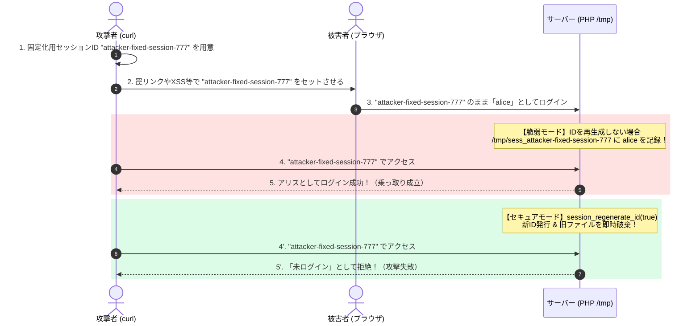

# Phase 1-2: セッション固定化攻撃（Session Fixation）とセッションID再生成

## 1. 概要
セッション管理のセキュリティにおいて最も基本的かつ致命的な脆弱性の1つである「セッション固定化攻撃（Session Fixation）」を取り上げます。
攻撃者が被害者にセッションIDを「押し付け（固定化させ）」、被害者がログインした瞬間にアカウントを乗っ取る手口をハンズオンで再現し、`session_regenerate_id(true)` による根本防御を学びました。

---

## 2. セッションハイジャックとの違い
- **セッションハイジャック（Session Hijacking）**:
  被害者がログインした **後** に、通信傍受やXSS等で被害者のセッションIDを「盗み取る（後追いで奪う）」攻撃。
- **セッション固定化（Session Fixation）**:
  被害者がログインする **前** に、攻撃者が用意したセッションIDを被害者に「使わせる（先に仕込む）」攻撃。



---

## 3. 防御の要点
- **`session_regenerate_id(true)` の実行**:
  ログイン成功時（認証境界を越えるタイミング）で、必ずセッションIDを新しく発行し直し、古いセッションファイルを即時破棄する。
- **`session.use_strict_mode = 1`**:
  PHP側で初期化されていない未登録のセッションIDをクライアントが指定してきた場合、それを拒否して強制的に新しいIDを発行する（※未初期化IDの固定化をPHPコアレベルで無効化する重要設定）。

---

## 4. 実験と検証結果

### (1) セッションとログインの紐付けの正体
PHPのセッションの実体は、サーバー内部（Dockerコンテナ内）の `/tmp/sess_<セッションID>` というテキストファイル。
ログイン時に `$_SESSION['authenticated_user'] = 'alice'` をセットすると、該当IDのファイルに以下のように書き込まれる：
```text
authenticated_user|s:5:"alice";login_time|s:19:"2026-10-17 04:21:24";
```
リクエストが届くたびに、届いたCookieのセッションIDに対応するファイルを読み込むため、攻撃者が同じIDを持っていれば誰でもそのユーザーになりすませる。

### (2) `session_regenerate_id(true)` による防御の物理的証拠
セキュアモードでログインを実行した直後のコンテナ内ファイル状態：
```text
-rw------- 1 www-data www-data  0 Oct 17 04:31 /tmp/sess_attacker-fixed-session-777 (旧ファイル: 0バイトに破棄)
-rw------- 1 www-data www-data 69 Oct 17 04:31 /tmp/sess_2348638d23bf8021597e...     (新ファイル: aliceのデータ移動)
```
- 旧セッションIDの中身が空（破棄）になったため、攻撃者の `curl` は「未ログイン」となり乗っ取りが阻止された。
- 被害者のブラウザには新しいセッションIDが配布され、何の影響もなくログイン状態を継続できた。

---

## 5. セキュリティ上の超重要原則

### ① セッションIDの漏洩は「即アウト（完全乗っ取り）」
- 標準的なWeb通信では、サーバーは接続元IPやUser-Agentではなく「Cookie内のセッションID」だけを信頼して認証状態を判定する。
- IPアドレスをセッションに厳密にバインドすると、モバイル回線の切り替え（4G/5G/Wi-Fi）で正常なユーザーが意図せずログアウトされる等の問題が生じる。
- したがって、セッションIDそのものを漏洩させない防御（HTTPS, `HttpOnly`, `SameSite` 等）が不可欠。

### ② 認証状態の変化点では必ず `session_regenerate_id(true)` を呼ぶ
- **ログイン成功時**: 最優先。未認証時のセッションIDを捨て、新しいIDを発行する。
- **引数には必ず `true` を渡す**: `false` だと古いセッションファイルがサーバー上に残り続け、攻撃者がアクセス可能になってしまう。
- **ログアウト時**: `$_SESSION = [];` で変数をクリアし、`session_destroy()` でサーバー側ファイルを破棄し、Cookieも過去期限にしてブラウザから消去する。
