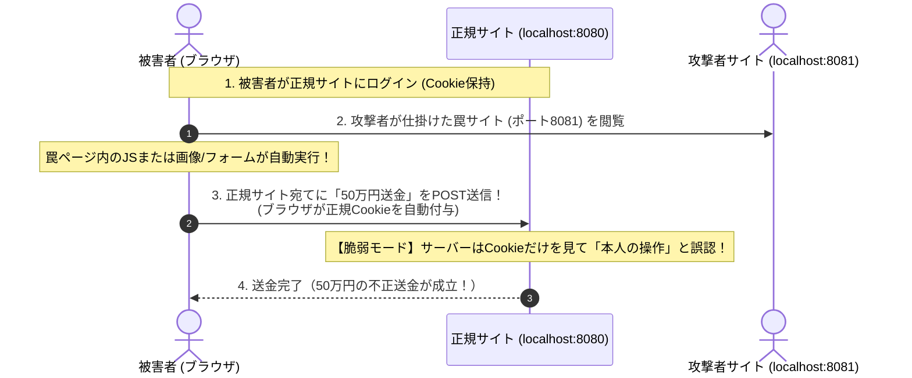

# Phase 2-2: クロスサイトリクエストフォージェリ（CSRF）とワンタイムトークン検証

## 1. 概要
Webアプリケーションにおける代表的ななりすまし脆弱性である「CSRF（Cross-Site Request Forgery: クロスサイトリクエストフォージェリ）」を取り上げます。
独立した攻撃者専用Webサーバー（別ポート・別オリジン）をオンデマンドで立ち上げ、被害者のセッションを悪用して意図しない状態変更（パスワード変更や退会、送金など）を勝手に実行させる攻撃を再現し、**暗号学的ワンタイムトークン（CSRFトークン）による防御** を学びました。

---

## 2. CSRFの発生メカニズム
ブラウザには、**「あるドメイン宛てにHTTPリクエストを送る際、保存されているそのドメインのCookieを自動的に付与して送信する」** という根本的な仕様があります。

攻撃者はこの仕様を悪用し、被害者に罠サイトを踏ませることで、被害者のブラウザから標的サーバーへ「認証Cookie付きの偽造リクエスト」を強制的に送信させます。

---

## 3. 防御の要点
1. **暗号学的CSRFトークン（ワンタイムトークン）**:
   - サーバー側で推測不可能なランダム文字列（`bin2hex(random_bytes(32))`）を生成し、セッションに保存。
   - フォームの `<input type="hidden" name="csrf_token" value="...">` に埋め込む。
   - 送信時、セッション内のトークンと照合（タイミング攻撃耐性のある `hash_equals()` を使用）。
   - **なぜ防げるのか？**: 攻撃者サイトは同一オリジンポリシー（SOP）により、被害者のセッションや正規ページのHTML内にあるトークンを読み取ることができないため、偽造リクエストに正しいトークンを乗せられない。
2. **`SameSite` 属性との多層防御**:
   - Cookieの `SameSite=Lax` または `Strict` により、外部サイトからのPOST送信時にCookie付与を拒絶する。
3. **副作用（状態変更）を伴う処理に GET メソッドを使わない**:
   - GETはキャッシュされたり、`` タグ等で無断アクセスされたりするため、データ変更は必ずPOST/PUT/DELETEで行う。

---

## 4. 実験と検証結果

### (1) 攻撃者コンテナ連携（ポート 8081）によるCSRF攻撃の実証
Docker Composeに独立した攻撃者サーバー（`security-lab-attacker`: ポート 8081）を追加し、別オリジンからのクロスサイト攻撃を再現した。

| モード | 攻撃サイト（ポート8081）からの偽造POST | 銀行サーバーの判定 | 結果 |
| :--- | :--- | :--- | :--- |
| **1. 脆弱モード** | クエリなしで `to_account=attacker&amount=500000` をPOST | Cookieの存在のみで本人操作とみなす | 🚨 **送金成立（残高が勝手に50万円減少）** |
| **2. 防御モード** | トークンなし（または不正トークン）でPOST | `hash_equals()` で照合し不一致を検知 | 🛡️ **送金拒否（攻撃を遮断し残高保護）** |

### (2) セキュリティステート管理の教訓
当初、防御のON/OFFをURLクエリパラメータ（`?protect=1`）で判定していた際、攻撃者のフォーム（クエリパラメータなしのURL）からのアクセスによって防御判定がバイパスされる現象を分析・解決した。
セキュリティ機能の有効状態はクライアントが任意に指定できるURLに依存させるのではなく、**サーバーサイドセッション（`$_SESSION['csrf_protection']`）に保持して状態を維持する** 必要性を体感した。

---

## 5. セキュリティ上の超重要原則

### ① CSRFとXSSの本質的違い
- **XSS**: 標的サイト自身に悪意あるスクリプトを注入し、標的サイトのドメイン上でコードを実行させる。
- **CSRF**: 標的サイト自体は1文字も改ざんされておらず、攻撃者の罠サイト上で実行されたリクエストが、被害者のログイン権限（Cookie）を「タダ乗り」して悪用される。

### ② タイミング攻撃（Timing Attack）と `hash_equals()`
- 通常の `===` 比較は、先頭から1文字ずつ比較し不一致を見つけた瞬間に早期リターン（Early Exit）する。
- 攻撃者はマイクロ秒単位の処理時間の違いを計測することで、正解のトークンを1文字ずつ推測・解読できる。
- 暗号トークンやハッシュ値の照合には、常に一定時間で比較を行う **`hash_equals()`** を使用することが不可欠。

### ③ SOP（同一オリジンポリシー）の保護境界
- ブラウザは他サイトへ「リクエストを送りつけること（Write操作）」は許可してしまうが、**「他サイトのページ内容（HTMLやCookie）をJavaScriptで盗み見ること（Read操作）」はSOPが絶対に遮断する**。
- だからこそ、HTML内にしか存在しないランダムなCSRFトークンを攻撃者は入手できず、偽造リクエストに付与できない。
