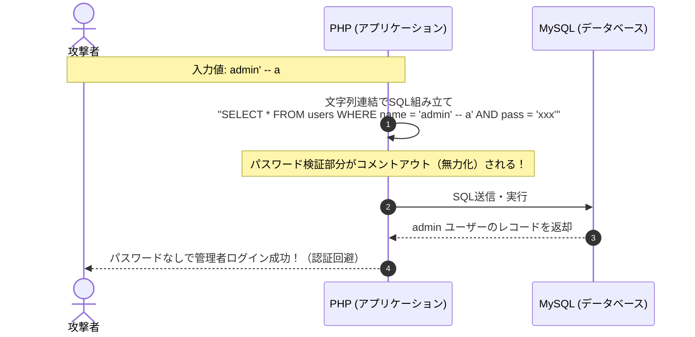

# Phase 2-3: SQLインジェクション（SQLi）とPDOプリペアドステートメント

## 1. 概要
Webデータベース連動アプリケーションにおいて最も破壊的な脆弱性である「SQLインジェクション（SQLi: SQL Injection）」を取り上げます。
オンデマンドでMySQLコンテナを追加し、認証回避（`admin' -- ` や `' OR '1'='1`）、UNIONベースの秘密情報（管理者パスワードやAPIキー）漏洩、およびプレースホルダーが使えない箇所（動的ソート等）の安全な実装（ホワイトリスト検証）を学びました。

---

## 2. SQLインジェクションの発生メカニズム
XSSが「HTMLとJavaScriptの混同」であったのと同様に、SQLiは **「SQLの文法（コマンド）とユーザー入力値（データ）の混同」** によって発生します。

文字列連結（`$sql = "SELECT * FROM users WHERE username = '" . $input . "'"`）でSQL文を組み立てると、攻撃者が `'`（シングルクォート）などのメタ文字を入力することで、**開発者の意図しないSQL構文を勝手に作り出す** ことができてしまいます。

---

## 3. 防御の要点
1. **PDOプリペアドステートメント（プレースホルダー）の利用**:
   - SQLの「構文解析（パース）」と「値（パラメータ）の割り当て」をデータベースエンジン側で完全に分離する。
   - `prepare("SELECT * FROM users WHERE username = :name AND password = :pass")`
   - `execute([':name' => $name, ':pass' => $pass])`
   - どんな悪意ある記号（`'` や `--` や `OR 1=1`）が渡されても、DBはそれを「構文」ではなく単なる「文字列データ」として解釈するため、100%安全に無力化される。
2. **プレースホルダーが使えない箇所の対策（ホワイトリスト検証）**:
   - テーブル名、カラム名、`ORDER BY ASC/DESC` などは、SQLの仕様上プレースホルダー（`:placeholder`）が使用できない。
   - これらの箇所をユーザー入力で動的制御する場合は、**許可リスト（ホワイトリスト）** と厳密に照合し、一致したものだけをSQLに結合する。

---

## 4. 実験と検証結果

### (1) 3つの攻撃シナリオの実証と防御

| 攻撃シナリオ | 脆弱モードでの攻撃動作 | 防御モードでの挙動（対策技術） |
| :--- | :--- | :--- |
| **① 認証回避** | `admin' -- a` でパスワード判定をコメントアウトし、管理者ログインに成功 | プレースホルダーにより「そういう文字列のユーザー名」として検索され、不正ログインを完全遮断 |
| **② UNION情報漏洩** | `' UNION SELECT id, username, 0, 0, secret_api_key FROM users -- a` で、商品一覧画面に `users` テーブルの管理者秘密APIキーが流出 | プレースホルダー（`LIKE :keyword` に `%{$q}%` を値バインド）により0件ヒットで安全に終了 |
| **③ ORDER BY ブラインドSQLi** | `(CASE WHEN (SELECT SUBSTRING(password,1,1)...='S') THEN price ELSE stock END)` で並び順の変化からパスワードを1文字ずつ特定 | ホワイトリスト検証（`in_array`）により、許可リスト外のSQL式を安全なデフォルト値（`price`, `ASC`）へ強制丸め込み |

### (2) SQLの文法・演算子順位の重要知見
- **`AND` は `OR` より優先される**:
  `WHERE user = '' OR '1'='1' AND pass = ''` は、`AND` が先に結合されるため失敗する。これを突破するために攻撃者はコメントアウト（`-- `）を使うか、パスワード欄に `' OR '1'='1` を注入する。
- **MySQLのコメント記号の制約**:
  MySQLでは `--`（ハイフン2つ）の直後に **空白文字（スペース等）** が必須。末尾のスペースがブラウザ等で削られるのを防ぐため、ペネトレーションテストでは `-- a` のようにダミー文字を添える。

---

## 5. セキュリティ上の超重要原則

### ① プリペアドステートメントはなぜ100%安全なのか
- DBエンジンはプリペアの段階で「SQL構文木（AST）」を確定させ、実行計画をロックする。
- 後から流し込まれるパラメータは「純粋なバイナリデータ」としてスロットに収まるため、データ内の記号によって構文構造が変化することは物理的にあり得ない。

### ② PDOエミュレーション（`ATTR_EMULATE_PREPARES`）は必ず `false` にする
- エミュレーション有効（`true`）の場合、PHP側で文字列置換した単一のSQLが生成されるため、文字セット（マルチバイト等）の解釈ズレによるエスケープすり抜けリスクが残る。
- `false` を指定して、MySQLサーバーネイティブの2フェーズ通信（`COM_STMT_PREPARE` / `COM_STMT_EXECUTE`）を強制することが実務の絶対鉄則。

### ③ プレースホルダーが使えない場所は「ホワイトリスト」が唯一の防壁
- `ORDER BY` のカラム名やソート順（`ASC`/`DESC`）はSQLの構文を決定づけるメタデータであるためプレースホルダーが使えない。
- 許可する文字列配列（ホワイトリスト）と厳密に照合し、許可リスト外の入力は安全な初期値にフォールバックさせる。
