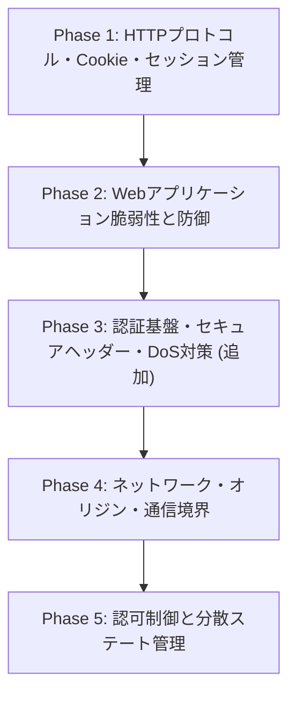

# Web Security Hands-on Lab (PHP 8.5) - 学習ロードマップ

本プロジェクトは、Docker環境（Nginx + PHP 8.5-FPM）を用いてWebセキュリティの核心（プロトコル、ブラウザ保護機能、Web脆弱性、境界防御、認証・認可）を攻撃・防御の両面から深く理解するためのハンズオンラボです。

---

## メンター提案による拡張カリキュラム概要
当初の4フェーズに加え、実務・モダンWeb開発において極めて重要度が高い**「認証基盤の暗号学的安全性」「クリックジャッキングやキャッシュ制御などのブラウザセキュリティヘッダー」「DoS・ブルートフォース対策」**を体系的に組み込みました。

---

## 全体カリキュラム

### Phase 1: HTTPプロトコル・Cookie属性・セッション管理の基礎
Webセキュリティの根幹となるステート管理とCookieの挙動を、生HTTPレベルで紐解きます。
- **1-1. 生のHTTPヘッダーとCookie挙動の観察**
  - `Set-Cookie`, `Cookie` ヘッダーの生テキスト解析
  - `Path`, `Domain`, `Expires` / `Max-Age` の制約とブラウザ送信ルール
  - Nginx ⇔ PHP-FPM 間の FastCGI プロトコルヘッダー伝播
- **1-2. セッション固定化攻撃（Session Fixation）**
  - 攻撃シナリオ: 攻撃者が指定したPHPSESSIDを被害者に踏ませる攻撃実証
  - 防御策: `session_regenerate_id(true)` のタイミングと古いセッション破棄
- **1-3. セッションハイジャックとCookie保護属性**
  - `HttpOnly`: XSS経由の `document.cookie` 窃取遮断
  - `Secure`: 平文通信時のCookie送出防止
  - `SameSite` (`Lax` / `Strict` / `None`): クロスサイトリクエスト時の送信制限とCSRF耐性

---

### Phase 2: Webアプリケーション主要脆弱性と防御
OWASP Top 10の常連であるコードレベルの脆弱性を、攻撃コード作成とセキュアコーディングの両面で習得します。
- **2-1. クロスサイトスクリプティング（XSS）**
  - 反射型XSS / 格納型XSSの再現（ペイロード作成）
  - 文脈に応じたエスケープ（HTML本文、属性値、JavaScript文脈）と `htmlspecialchars()` の正確なオプション
  - 多層防御としての CSP (Content Security Policy) ヘッダーの導入
- **2-2. クロスサイトリクエストフォージェリ（CSRF）**
  - *【オンデマンド追加: 攻撃者用サイトコンテナ（別オリジン）】*
  - 被害者のセッション悪用による意図しない状態変更（送金・パスワード変更等）の再現
  - 自作ワンタイムトークン（CSRFトークン）生成・セッション保存・照合ロジック
  - `SameSite` 属性とCSRFトークンの役割分担
- **2-3. SQLインジェクション（SQLi）**
  - *【オンデマンド追加: MySQLコンテナ】*
  - 認証回避 (`' OR '1'='1`)、UNIONベースの情報漏洩、ブラインドSQLiの実験
  - PDOプリペアドステートメント（プレースホルダー）による根本的防御
  - 動的ソートカラム（ORDER BY等）などプレースホルダーが使えない箇所の安全な実装（ホワイトリスト検証）

---

### Phase 3: 認証基盤・セキュアヘッダー・DoS防御
実務のWebアプリケーション開発で必須となる認証の安全性と耐攻撃性、ブラウザ保護ヘッダーを掘り下げます。
- **3-1. パスワードの安全な保存と認証**
  - 単純ハッシュ（MD5/SHA256）とレインボーテーブル攻撃の危険性
  - `password_hash()` / `password_verify()` を用いたストレッチング・ソルト付与（Argon2id, BCRYPT）の実装
- **3-2. ブルートフォース・認証試行レートリミット**
  - ログインエンドポイントへの総当たり攻撃の実演
  - Nginxレベルでの接続制限（`limit_req_zone`）およびアプリケーション側でのロックアウト設計
- **3-3. クリックジャッキングとオープンリダイレクト**
  - `<iframe>` 内への透明埋め込みによるクリック誘導の再現
  - `X-Frame-Options` (`DENY` / `SAMEORIGIN`) と CSP `frame-ancestors` による防御
  - ログイン後リダイレクト等を狙ったオープンリダイレクト脆弱性とURLホワイトリスト検証
- **3-4. 機微情報のキャッシュ漏洩とMIMEスニッフィング**
  - 共有端末やプロキシでのキャッシュ事故を防ぐ `Cache-Control: no-store, private`
  - `X-Content-Type-Options: nosniff` による不正スクリプト実行防止

---

### Phase 4: ネットワーク・オリジン・通信境界
ブラウザのセキュリティ境界（SOP）と、インフラ・リバースプロキシ境界のセキュリティを検証します。
- **4-1. 同一オリジンポリシー（SOP）と CORS**
  - オリジン（スキーム・ホスト・ポート）の判定ルール
  - Simple Request と Preflight (`OPTIONS`) Request の観察
  - `Access-Control-Allow-Origin: *` と `Access-Control-Allow-Credentials: true` の危険な組み合わせと正しいCORS設計
- **4-2. ローカルHTTPS化とトランスポート層セキュリティ**
  - *【オンデマンド設定: Nginx SSL/TLS証明書設定】*
  - 平文HTTPでのパケット盗聴（Cookie/認証情報漏洩）の観察
  - HTTPS化と `Secure` 属性の強制、HSTS (`Strict-Transport-Security`) によるSSL Stripping攻撃耐性
- **4-3. プロキシヘッダーと信頼性境界**
  - `X-Forwarded-For`, `X-Real-IP`, `X-Forwarded-Proto` の仕組み
  - クライアント偽装によるIP制限バイパス攻撃の再現
  - Nginxの `set_real_ip_from` を用いた信頼できるプロキシの定義と境界防御
- **4-4. SSRF（Server-Side Request Forgery）**
  - 外部URLフェッチ機能（Webhook、画像プレビュー等）を悪用した内部ネットワーク探索・クラウドメタデータアクセス
  - DNS Rebinding対策、プライベートIP（RFC 1918 / Loopback）宛て通信の検証・遮断ロジック

---

### Phase 5: 認可制御と分散ステート管理
単一サーバーから実運用に近いスケーラブルな構成におけるセキュリティ設計を学びます。
- **5-1. 認可制御の不備（BOLA / IDOR / 垂直昇格）**
  - 水平権限昇格（IDOR）: パラメータ書き換えによる他ユーザーの注文・個人情報閲覧
  - 垂直権限昇格: 一般ユーザーによる管理エンドポイント実行
  - ロールベースアクセス制御（RBAC）の実装
- **5-2. 分散環境でのセッション外部ストア化（Redis）**
  - *【オンデマンド追加: Redisコンテナ】*
  - PHPの `SessionHandlerInterface` を自作実装
  - セッションハイジャック検知、セッション無効化の集中管理
